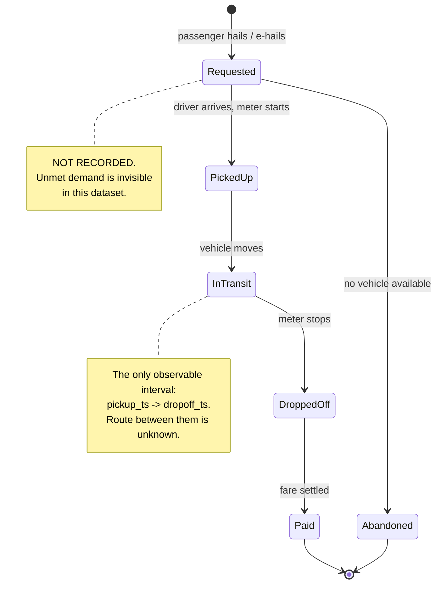
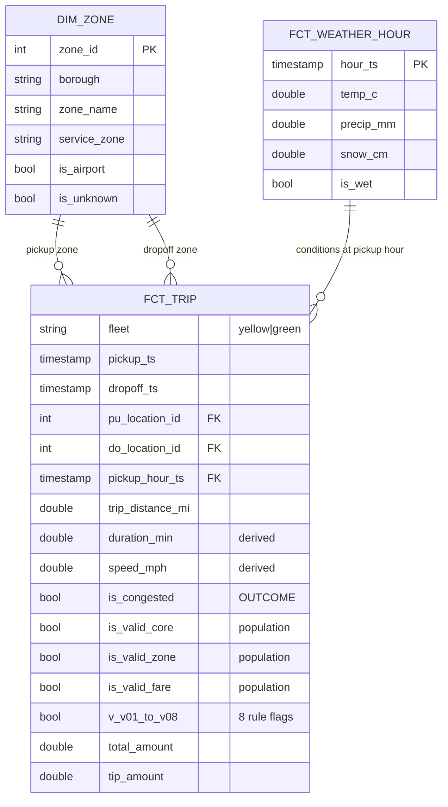

# Workflow and data model

## 1. The operational workflow being modelled

A taxi trip is a short state machine. The TLC extract records only the
*completed* path through it:



**What the data gives us:** two timestamps, two zones, a distance, a fare.
**What it withholds:** the request, the route, and every trip that never
happened. The model is built around that boundary rather than pretending
past it.

The interval `pickup_ts → dropoff_ts` combined with `trip_distance_mi` is
the whole basis of the KPI: it yields an average speed, and average speed
is the closest observable proxy for "was this trip impeded?".

## 2. Entity / event model

A small star schema. One event table, three context tables.



### Grain

| Table | Grain | Rows (6 months) |
|---|---|---|
| `fct_trip` | one completed trip | 20,671,900 |
| `dim_zone` | one taxi zone | 265 |
| `fct_weather_hour` | one hour of NYC weather | 4,368 |

`fct_trip` is an **event table**: one immutable row per real-world
occurrence, never updated. This is what makes monthly reprocessing safe —
there is no accumulating state to corrupt.

### Interactions, interventions, outcomes

Mapping the assignment's vocabulary onto this domain:

- **Entity:** the zone (where service is delivered), the fleet (who
  delivers it).
- **Event:** the trip — pickup → dropoff → payment.
- **Interaction / condition:** weather at the pickup hour, and the
  structural context (borough, hour of day, weekend, airport).
- **Outcome:** `is_congested` — did this trip average below 8 mph?
- **Intervention (what the KPI informs):** where and when to deploy curb
  management, signal retiming or dispatch restrictions. The pipeline does
  not observe interventions; it produces the evidence used to target them,
  and the monthly series is the instrument for measuring whether one worked.

## 3. Derived fields

Three fields carry the analysis, and each is a deliberate choice:

| Field | Definition | Why this way |
|---|---|---|
| `duration_min` | `date_diff('second', pickup, dropoff) / 60` | Seconds, not minutes, as the base unit — minute truncation would distort short trips, which are the majority. |
| `speed_mph` | `distance / (duration_hours)`, NULL when duration ≤ 0 | Returns NULL rather than raising or yielding infinity; V01/V02 flag those rows separately, so a bad timestamp never becomes a fake speed. |
| `is_congested` | `speed_mph < 8.0`, NULL when not `is_valid_core` | NULL, not FALSE, outside the valid population — an invalid trip must not silently count as "not congested" and dilute the KPI. |

The `is_congested` NULL choice matters: `sum(CASE WHEN is_congested ...)`
over an invalid population would quietly understate the rate. Making it
NULL forces every consumer to filter to `is_valid_core` explicitly.

## 4. Why average speed, and why 8 mph

**Why speed rather than duration.** Duration alone cannot distinguish a
long trip from a slow one. A 40-minute run to JFK is not an operational
problem; a 40-minute crawl across Midtown is. Normalising by distance
makes trips comparable across the network — which is the only way a
borough-by-hour ranking means anything.

**Why 8 mph.** Calibrated against the observed distribution rather than
chosen for roundness. In 2024-01 the median trip speed was 9.7 mph
(p25 = 7.4, p75 = 13.1). A threshold of 8 mph sits just below the median
and flags ~31% of trips — a population large enough to act on and small
enough to prioritise. It also aligns with the ~8 mph figure widely cited
for Manhattan traffic speeds.

The threshold is a **judgement call, not a fact**, so it lives in
`config/pipeline.yaml` as `congested_speed_mph` and can be changed in one
place. The sensitivity of the KPI to it is quantified in
`docs/known_unknowns.md`.

## 5. Physical layout

```
data/
├── raw/          immutable downloads + manifest.json (URL, SHA-256, size)
├── staging/      fct_trip, partitioned month=YYYY-MM
└── marts/        one directory per metric, partitioned month=YYYY-MM
```

Partitioning by month is what delivers idempotency: reprocessing a month
removes and rewrites exactly one directory, so a rerun can neither
double-count nor disturb a neighbouring month.
